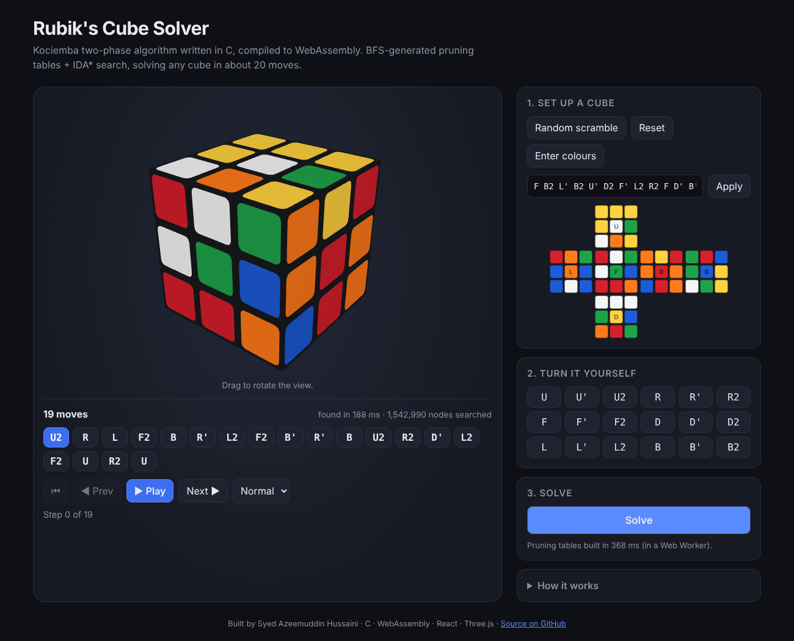

# Rubik's Cube Solver

A Rubik's Cube solver written in **C** using Kociemba's two-phase algorithm, compiled to **WebAssembly** and wrapped in an interactive **React + Three.js** frontend. Enter any cube state, by scrambling it or by painting the stickers, and watch the solution play back step by step in 3D.

**[Live demo](https://azeemzsyed.github.io/rubiks-cube-solver/)**



## Features

- **Solves any valid cube in about 20 moves** (average 20.6 over 200 random cubes, max 23), typically in under 200 ms in the browser
- **C solver compiled to WebAssembly** with plain `clang` (no Emscripten, no libc), only 28 KB
- **Runs in a Web Worker**, so building the 7 MB of lookup tables never freezes the page
- **3D cube** with orbit controls and animated layer turns
- **Enter any state**: paint stickers on the 3D cube or on the 2D net; invalid states (flipped edge, twisted corner, swapped pieces, wrong colour counts) get a clear error message
- **Step-by-step playback**: play/pause, previous/next, jump to any move, three speeds, keyboard shortcuts (← → space)
- **Tested**: 6,000+ C unit checks, plus JavaScript tests that cross-check the browser's cube model against the C model

## How it works

### Cube model
The C solver stores the cube at the *cubie* level: which corner/edge piece is in each position, and how it is twisted or flipped. Each face turn is a permutation, and applying a move is a group multiplication. Parts of the state are mapped to small integers called **coordinates**:

| Coordinate | Meaning | Size |
|---|---|---|
| twist | orientation of the corners | 3⁷ = 2,187 |
| flip | orientation of the edges | 2¹¹ = 2,048 |
| slice | which positions hold the 4 middle-layer edges | C(12,4) = 495 |
| cperm | corner permutation | 8! = 40,320 |
| eperm | permutation of the 8 top/bottom-layer edges | 8! = 40,320 |
| sperm | permutation of the 4 middle-layer edges | 4! = 24 |

### Two-phase search
1. **Phase 1**: IDA* search from the scrambled cube into the subgroup **H = ⟨U, D, R2, L2, F2, B2⟩**, where every piece is correctly oriented and the middle-layer edges are in the middle layer.
2. **Phase 2**: IDA* search inside H, using only H moves, until the cube is solved.

### Pruning tables (BFS)
IDA* needs a heuristic that never overestimates. When the solver starts, it runs a **breadth-first search** from the solved state over pairs of coordinates (e.g. slice × twist, about 1 million states) and records the exact distance of every state. The heuristic at any node is the maximum over the relevant tables. Move tables (coordinate × move → new coordinate) make each search step a few array lookups.

### Finding shorter solutions
After finding a first solution, the search keeps exploring longer phase-1 paths that might allow a shorter phase 2, within a node budget. Duplicate paths are pruned by never turning the same face twice in a row and fixing the order of opposite faces (U D but never D U).

## Project structure

```
solver/
  src/cube.c          cubie model, facelet conversion, validation, coordinates
  src/solver.c        move tables, BFS pruning tables, two-phase IDA* search
  src/api.c           string API used by both WebAssembly and the CLI
  src/cli.c           command-line tool (native build only)
  src/wasm_support.c  memset/memcpy for the libc-free WebAssembly build
  tests/test_solver.c unit + randomized tests
web/
  src/cube/model.js        facelet model; move permutations derived from 3D geometry
  src/components/CubeView  Three.js cube with animated turns and sticker picking
  src/solver/              WebAssembly wrapper, Web Worker, React hook
  tests/solver.test.js     cross-checks JS model against the C model
```

## Running it

### C solver (native)
```bash
cd solver
make test                       # run the test suite
make                            # build the CLI
./rubik -s "R U R' U' F2 D L' B"
./rubik UUFUUFUUFRRRRRRRRRFFDFFDFFDDDBDDBDDBLLLLLLLLLUBBUBBUBB
```

### WebAssembly + web app
```bash
cd solver && make wasm          # writes web/public/solver.wasm (needs clang + wasm-ld)
cd ../web
npm install
npm test                        # JS <-> C cross-check tests
npm run dev                     # http://localhost:5173/rubiks-cube-solver/
```

### Deployment
Pushing to `main` runs the tests, builds the site and publishes it to the `gh-pages` branch via `.github/workflows/deploy.yml`. GitHub Pages serves that branch (**Settings → Pages → Deploy from a branch → gh-pages**).

## Facelet format

A cube state is 54 letters (`U R F D L B`, one per sticker) in this order:

```
             U1 U2 U3
             U4 U5 U6
             U7 U8 U9
 L1 L2 L3    F1 F2 F3    R1 R2 R3    B1 B2 B3
 L4 L5 L6    F4 F5 F6    R4 R5 R6    B4 B5 B6
 L7 L8 L9    F7 F8 F9    R7 R8 R9    B7 B8 B9
             D1 D2 D3
             D4 D5 D6
             D7 D8 D9
```
The string is written face by face: all of U, then R, F, D, L, B.

## Tech
C99 · WebAssembly (clang/wasm-ld) · JavaScript · React · Three.js · Vite · GitHub Actions

## License
MIT
